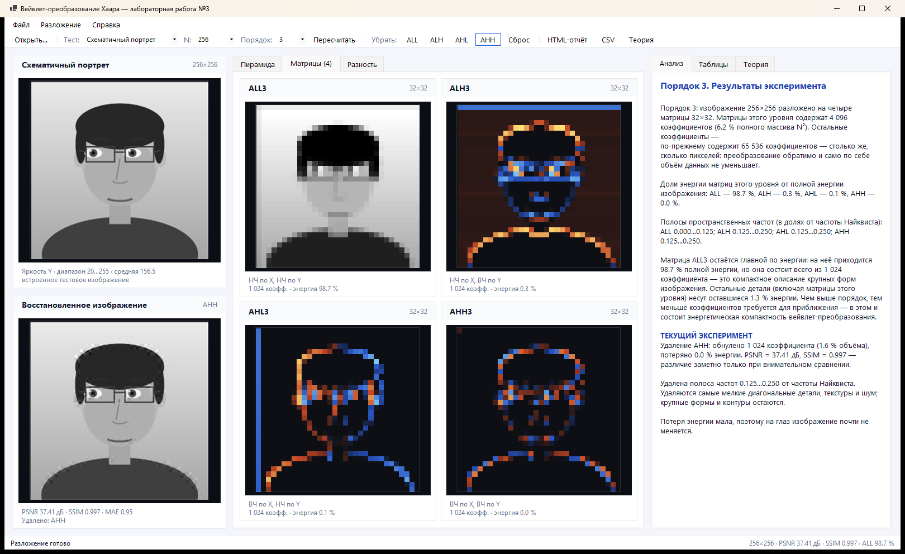

# Лабораторная работа №3 — вейвлет-преобразование изображений (Хаар)

Учебная программа по дисциплине **«Основы цифрового телевидения»**.  
Прямое и обратное вейвлет-преобразование Хаара, разложение изображения до 5 порядка,
поочерёдное удаление матриц ALL / ALH / AHL / AHH, оценка качества, сжатие и автономный HTML-отчёт.

**Платформа:** C# / .NET 10, Windows Forms, System.Drawing.  
**Оформление:** по образцу лабораторной работы №1 (меню, теория, CSV, HTML+SVG-отчёт, `--report`).



---

## 1. Что делает программа

| Возможность | Подробности |
|---|---|
| Загрузка изображения | PNG, JPG/JPEG, BMP, GIF, TIFF; также 5 встроенных тестовых изображений |
| Приведение к N×N | центральный квадрат, масштабирование до степени двойки: 128, 256, 512, 1024 |
| Полутоновой режим | яркость Y = 0.299R + 0.587G + 0.114B (BT.601) |
| Прямое преобразование | Хаар, сначала по строкам (X), затем по столбцам (Y), рекурсивно до порядка 1…5 |
| Матрицы | ALL (приближение), ALH, AHL, AHH — теплокарты и числовые значения |
| Обратное преобразование | полное восстановление (контроль обратимости) |
| Удаление матриц | поочерёдно ALL, ALH, AHL, AHH и любая комбинация; сравнение «до / после / разность» |
| Метрики | MSE, PSNR, SSIM (блоки 8×8), MAE, максимальная ошибка, корреляция |
| Сжатие | 1) только приближение ALL<sub>k</sub>; 2) отбрасывание малых коэффициентов по порогу |
| Отчёт | автономный `report.html`: таблицы, 47 изображений, 9 SVG-графиков, теория, контрольные вопросы |
| CSV | 7 файлов для Excel: матрицы, эксперименты, сжатие, коэффициенты, яркости, проверка по методичке |
| Режимы | окно WinForms, консольное меню, неинтерактивный `--report`, самопроверка `--selftest` |
| Обучение | вкладка «Теория», формулы, структурные схемы, ответы на 8 контрольных вопросов, автоматические выводы |

---

## 2. Быстрый запуск

### Вариант А — готовый exe

```
TVSignalLab\Lab3\publish\HaarWaveletLab.exe
```

Двойной щелчок открывает окно программы. Рядом должен находиться `HaarWaveletLab.dll`
(публикация framework-dependent, требуется .NET 10 Desktop Runtime).

### Вариант Б — из исходников

```
cd TVSignalLab\Lab3
dotnet run
```

Требуется .NET SDK 10 (проект проверен на 10.0.401).

### Самопроверка

```
HaarWaveletLab.exe --selftest
```

Проверяются: 1D/2D прямое и обратное преобразование, равенство Парсеваля, покрытие
коэффициентов, метрики, тестовые изображения, генерация отчёта и CSV, сверка с Lb3_Haar.xlsx.
Результат дублируется в `selftest.log` рядом с exe. Успешный запуск — 12 проверок, код возврата 0.

---

## 3. Режимы и параметры командной строки

| Параметр | Значение |
|---|---|
| *(без параметров)* | окно программы |
| `--console`, `-c` | консольное меню (в стиле лабораторной №1) |
| `--report`, `-r`, `--demo` | HTML-отчёт и CSV без интерфейса |
| `--selftest` | самопроверка математики, отчёта и CSV |
| `--help`, `-h` | справка |
| `--image <файл>` | исходное изображение |
| `--test <id>` | встроенное: `testcard`, `bars`, `geometry`, `portrait`, `texture` |
| `--size <N>` | размер N×N: 128, 256, 512, 1024 (округляется вниз до степени двойки) |
| `--order <1..5>` | максимальный порядок разложения |
| `--out <файл.html>` | путь отчёта (по умолчанию `report.html` рядом с exe) |
| `--csv <папка>` | папка CSV (по умолчанию `csv` рядом с exe) |
| `--no-csv` | не создавать CSV в режиме `--report` |
| `--remove ALL,ALH` | матрицы, удалённые при открытии окна |
| `--tab <вкладка>` | стартовая вкладка: `pyramid`, `matrices`, `difference`, `analysis`, `tables`, `theory` |

Примеры:

```
HaarWaveletLab.exe --report --test portrait --size 512 --order 5
HaarWaveletLab.exe --report --image C:\foto.jpg --out C:\reports\lab3.html
HaarWaveletLab.exe --image C:\foto.jpg --order 3 --remove AHH --tab matrices
HaarWaveletLab.exe --console
```

В режиме `--console` программа подключается к родительской консоли (exe собран как WinExe).
Если консоль недоступна, вывод дублируется в `cli_output.log` рядом с exe.

---

## 4. Работа в окне

1. **Изображение.** «Открыть…» или список «Тест». Размер N и порядок выбираются на панели сверху.
2. **Пирамида.** Вкладка «Пирамида» показывает полную матрицу коэффициентов: ALL — серые градации,
   детали — синий (отрицательные) и жёлтый (положительные), логарифмическая нормировка.
3. **Матрицы.** Вкладка «Матрицы (4)» — четыре теплокарты текущего порядка с размером, числом
   коэффициентов и долей энергии.
4. **Удаление.** Кнопки ALL / ALH / AHL / AHH (можно несколько сразу) обнуляют выбранные матрицы,
   выполняют обратное преобразование и обновляют:
   - восстановленное изображение и его метрики;
   - карту разности (усиление ×4);
   - вкладку «Анализ» с автоматическими выводами;
   - вкладку «Таблицы» со сравнением вариантов.
5. **Отчёт и CSV.** «HTML-отчёт» формирует автономный файл; «CSV» — набор таблиц для Excel.
6. **Теория.** Вкладка «Теория» или F1: теория, формулы, структурные схемы, ответы на контрольные вопросы.

Горячие клавиши: `Ctrl+O` — открыть, `F5` — пересчитать, `Ctrl+1…4` — убрать ALL/ALH/AHL/AHH,
`Ctrl+0` — сбросить удаление, `Ctrl+R` — отчёт, `F1` — теория.

---

## 5. Выходные файлы

| Файл | Содержание |
|---|---|
| `report.html` | автономный отчёт: теория, таблицы, изображения, SVG-графики, выводы |
| `report_assets/` | те же изображения отдельными PNG: пирамида, теплокарты, сравнения |
| `csv/01_bands.csv` | размеры, диапазоны, энергия и полосы частот всех матриц |
| `csv/02_experiments.csv` | PSNR, SSIM, MAE, потеря энергии, сжатие для всех экспериментов |
| `csv/03_compression.csv` | сжатие отбрасыванием малых коэффициентов |
| `csv/04_coefficients.csv` | полная матрица коэффициентов N×N |
| `csv/05_source_image.csv` | исходные яркости N×N |
| `csv/06_lb3_check.csv` | сверка с Lb3_Haar.xlsx |
| `csv/07_approximation.csv` | сжатие «только приближение ALL<sub>k</sub>» |

CSV пишутся в UTF-8 с BOM, разделитель — запятая, первой строкой `sep=,` для Excel.
Числа в CSV — с точкой (машинный формат), в интерфейсе и отчёте — тоже с точкой для единообразия.

---

## 6. Математика

### 6.1. Одномерное преобразование Хаара

Для пары соседних отсчётов:

```
s = (a + b) / √2      d = (a − b) / √2
a = (s + d) / √2      b = (s − d) / √2
```

Множитель 1/√2 делает базис ортонормированным, поэтому выполняется равенство Парсеваля:
сумма квадратов коэффициентов равна сумме квадратов отсчётов. Прямое преобразование
применяется рекурсивно к приближению: так получаются масштабы (уровни) 1, 2, 3, 4, 5.

### 6.2. Двумерное преобразование

Изображение A размера N×N:

1. **WTx** — один шаг преобразования по каждой строке: получаются N/2 приближений и N/2 деталей
   (матрицы AL и AH размером N/2 × N).
2. **WTy** — один шаг по каждому столбцу: получаются четыре матрицы (N/2) × (N/2).

Раскладка:

```
[ ALL  AHL ]
[ ALH  AHH ]
```

Вторая буква кода — ось X, третья — ось Y:

| Матрица | Частоты | Что содержит |
|---|---|---|
| ALL | НЧ по X, НЧ по Y | крупные формы, средняя яркость; основная энергия |
| AHL | ВЧ по X, НЧ по Y | вертикальные перепады (линии и границы, вытянутые по вертикали) |
| ALH | НЧ по X, ВЧ по Y | горизонтальные перепады (линии и границы, вытянутые по горизонтали) |
| AHH | ВЧ по X, ВЧ по Y | диагональные и самые тонкие детали, текстуры, шум |

Обратное преобразование выполняется в обратном порядке: IWTy, затем IWTx.

### 6.3. Объём данных

На уровне k матрицы имеют размер (N/2<sup>k</sup>) × (N/2<sup>k</sup>), то есть четыре матрицы
содержат 4·(N/2<sup>k</sup>)² коэффициентов — долю 1/4<sup>k−1</sup> полного массива.
Остальные коэффициенты — детали предыдущих уровней. Полная пирамида после любого числа
уровней по-прежнему содержит N² коэффициентов: преобразование обратимо. Сжатие появляется
только при квантовании и отбрасывании малых коэффициентов.

### 6.4. Частотные полосы

Если частоту Найквиста принять за 1:

- приближение ALL<sub>k</sub> занимает полосу `[0; 2^(−k)]`;
- детали уровня k — полосу `[2^(−k); 2^(1−k)]`.

Каждый следующий порядок сужает полосу приближения вдвое.

### 6.5. Метрики

```
MSE = (1/N²) · Σ (A − A′)²
PSNR = 10 · lg(255² / MSE)        (∞ при MSE = 0)
SSIM — среднее по неперекрывающимся блокам 8×8
```

---

## 7. Соответствие лабораторной работе №3

В отчёте для каждого порядка 1…5:

- показаны четыре матрицы (теплокарты + числовые фрагменты);
- поочерёдно удалены ALL, ALH, AHL, AHH и выполнено обратное преобразование;
- для каждого варианта приведены PSNR, SSIM, MAE, потеря энергии и доля сохранённых коэффициентов;
- автоматически сформулирован вывод: какую информацию несла матрица и как изменилось качество.

Типичные результаты для тестовой таблицы 256×256 (порядок 5):

| Матрица | Доля энергии | PSNR после удаления | Вывод |
|---|---:|---:|---|
| ALL | 90.0 % | 3.4 дБ | изображение темнеет, остаются контуры — потеря основной информации |
| ALH | 0.9 % | 22.8 дБ | пропадают горизонтальные перепады |
| AHL | 0.3 % | 27.8 дБ | пропадают вертикальные перепады |
| AHH | 0.2 % | 29.7 дБ | почти незаметно, теряются тонкие диагональные детали |

**Важное уточнение.** Удаление одной матрицы высокого порядка затрагивает меньше коэффициентов,
поэтому PSNR такого эксперимента может быть выше, чем на младшем уровне; программа показывает
измеренные значения, а не заранее заданную монотонность. Компромисс «сжатие — качество»
наглядно демонстрирует серия «только приближение ALL<sub>k</sub>» (раздел 7 отчёта): при росте
k сжатие растёт с 4× до 1024×, а PSNR падает с 18.2 до 12.2 дБ.

### Проверка по Lb3_Haar.xlsx

Раздел 8 отчёта воспроизводит данные файла `Lb3_Haar.xlsx`: базисную матрицу 8×8, два окна
по 8 отсчётов, коэффициенты Хаара и три варианта обнуления коэффициентов с расчётом P<sub>вх</sub>
и P<sub>вых</sub>. Небольшое расхождение (в четвёртом знаке) объясняется тем, что в xlsx базис
округлён до 4 знаков; программа показывает и точный расчёт с 1/√2, и расчёт с округлённой
матрицей файла.

---

## 8. Структура программы

| Файл / папка | Ответственность |
|---|---|
| `Program.cs` | точка входа, выбор режима, единая культура чисел |
| `App/CommandLineOptions.cs` | разбор параметров, справка |
| `App/ConsoleHost.cs` | подключение консоли для WinExe, дублирование в лог |
| `App/ConsoleMenu.cs` | консольное меню в стиле лабораторной №1 |
| `App/HeadlessRunner.cs` | режим `--report` |
| `App/SelfTest.cs` | самопроверка `--selftest` |
| `App/ReportService.cs` | загрузка входа, общие пути и запуск отчёта |
| `Models/` | матрицы, статистика, метрики, эксперименты |
| `Core/HaarTransform.cs` | прямое/обратное преобразование, шаги по X и Y |
| `Core/Metrics.cs` | MSE, PSNR, SSIM, MAE, корреляция |
| `Core/LabAnalyzer.cs` | удаление матриц, сжатие, только приближение |
| `Core/Lb3Reference.cs` | проверка по Lb3_Haar.xlsx |
| `Imaging/ImageLoader.cs` | загрузка, квадрат N×N, яркость Y |
| `Imaging/TestImages.cs` | 5 встроенных тестовых изображений |
| `Imaging/ImageRenderer.cs` | PNG, теплокарты, пирамида, сравнения |
| `Reporting/ReportModel.cs` | сбор всех результатов для отчёта |
| `Reporting/AnalysisText.cs` | автоматические текстовые выводы |
| `Reporting/SvgCharts.cs` | SVG-графики и схемы |
| `Reporting/HtmlReportGenerator.cs` | сборка автономного HTML |
| `Export/CsvExporter.cs` | 7 CSV-файлов для Excel |
| `Theory/LabTheory.cs` | теория, методика, контрольные вопросы |
| `UI/MainForm.cs` | главное окно |
| `UI/ImageBox.cs`, `UI/ImageCard.cs` | панели изображений и карточки |
| `UI/RichText.cs` | оформление вкладок «Анализ» и «Теория» |
| `docs/screenshot.png` | снимок интерфейса |
| `examples/` | пример готового отчёта и CSV |

---

## 9. Пример отчёта

```
TVSignalLab\Lab3\examples\report.html
```

Сформирован для встроенной тестовой таблицы 256×256, порядок 5. Открывается в любом браузере
без интернета: изображения встроены в HTML, графики — SVG. Рядом лежат `report_assets/`
и `csv/` с теми же данными.

---

## 10. Ограничения и замечания

- Обрабатывается **яркость Y**; цветовые каналы можно добавить тем же преобразованием независимо.
- Неквадратное изображение обрезается по центру и масштабируется до N×N; пропорции сохраняются.
- Размер N — степень двойки от 64 до 1024; в интерфейсе предлагаются 128, 256, 512, 1024.
- «Сжатие» в таблицах условное: по числу сохранённых коэффициентов, без энтропийного кодирования.
- PSNR и SSIM считаются по 8-битным значениям после ограничения диапазона 0…255.
- Отчёт из окна всегда строится для порядков 1…5; в `--report` количество порядков задаётся `--order`.
- Программа работает в Windows (WinForms, System.Drawing).

---

## 11. Использованные материалы

- `lab3/LR3.docx` — методические указания к лабораторной работе №3.
- `lab3/Lb3.xlsx` — базисные функции, прямое и обратное преобразование (ДКП/Хаар).
- `lab3/Lb3_Haar.xlsx` — базис Хаара 8×8, коэффициенты, P<sub>вх</sub>/P<sub>вых</sub>.
- `TVSignalLab/TVSignalLab1` — оформление лабораторной №1 (меню, теория, CSV, HTML, `--report`).

---

*Программа учебная: все расчёты выполняются в double, изображения — 8-битные полутоновые.*
